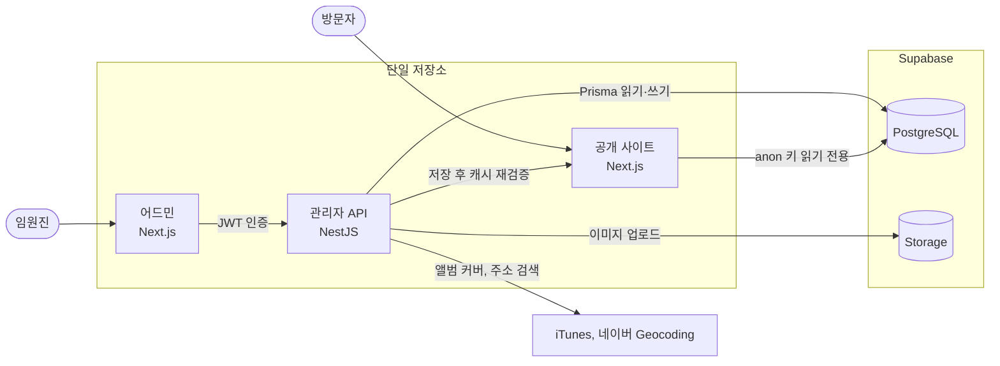

# SUMMIT Concert

숭실대학교 IT대학 X AI대학 연합 밴드 소모임 SUMMIT의 정기공연 정보를 제공하는 공개 사이트와, 임원진이 콘텐츠를 직접 관리하는 어드민을 함께 운영하는 풀스택 프로젝트입니다. 공개 사이트, 어드민, 관리자 API를 단일 저장소 멀티 앱 구성으로 관리합니다.

**서비스**: [summit-concert.live](https://summit-concert.live) · **상태**: 운영 중 · **기간**: 2026.04.23 ~ 진행 중 · **역할**: 기획, 디자인, 개발 1인

## 개요

2026년 여름 정기공연(6.25~26)에 맞춰 공개한 뒤 두 가지 문제가 드러났습니다. 동아리원들은 로딩이 느리다고 피드백했고, 공연 정보는 코드에 고정되어 있어 공연이 바뀔 때마다 코드를 고쳐 다시 배포해야 했습니다. 다음 겨울 정기공연(12.16~17)은 이 문제를 고친 구조로 준비하고 있습니다.

| 문제 | 해결 |
| --- | --- |
| 이미지와 카드 로딩이 느림 | Lighthouse와 코드로 원인을 진단하고, 이미지 크기와 데이터 조회 구조를 개선 |
| 포스터 1장을 바꾸는 데 6곳 이상 코드 수정이 필요했고, 페이지마다 공연장 주소가 달랐음 | 공연 정보를 DB 한 곳에서 관리하도록 옮김 |
| 비개발자 임원진이 콘텐츠를 직접 갱신할 수 없었음 | 어드민과 관리자 API를 구축하고, 저장 즉시 재배포 없이 공개 사이트에 반영 |

### 주요 기능

| 앱 | 기능 |
| --- | --- |
| 공개 사이트 | 공연 소개, 일차별 예매 링크, 셋리스트와 곡별 영상 연결, 타임 테이블, 티켓 안내, 공연장 지도, 관람 유의사항 |
| 어드민 | 관리자 로그인, 팀·곡 관리, 공연 순서 재정렬, 앨범 커버 자동 검색, 유튜브 연결 관리, 공연 기본 정보·공연장·일차별 공연·티켓·유의사항 편집, 이미지 업로드, 주소 검색과 지도 위치 보정 |

포스터와 팀 이미지는 자체 제작물입니다. 저장소에 라이선스를 두지 않았으므로 코드와 이미지를 재사용하려면 허락이 필요합니다.

## 시스템 아키텍처



공개 사이트는 RLS가 적용된 anon 키로 읽기만 하고, 모든 쓰기는 JWT 인증을 거친 관리자 API에서만 처리합니다. 세 앱은 패키지를 공유하지 않고 각자 의존성을 관리합니다.

| 앱 | 경로 | 역할 | 주요 스택 | 배포 |
| --- | --- | --- | --- | --- |
| 공개 사이트 | `src/` | 방문자용 공연 정보 | Next.js 16, Tailwind CSS 4, framer-motion, supabase-js | Vercel, `main` 자동 |
| 어드민 | `apps/admin` | 콘텐츠 관리 화면 | Next.js 16, TanStack Query, shadcn/ui, React Hook Form, Zod | Vercel, `main` 자동 |
| 관리자 API | `apps/api` | 인증, 쓰기, 업로드, 재검증 호출 | NestJS 12, Prisma 7, JWT, argon2 | AWS Lightsail, `develop` 수동 |

자세한 구조는 [관리자 API](apps/api/README.md), [어드민](apps/admin/README.md), [아키텍처와 의존성](docs/architecture.md) 문서를 참고하세요.

## 기술 결정 요약

**1. 성능 가설 수정** ([원문](REFACTOR_HYPOTHESIS_LOG.md))
- 문제: 로딩 지연의 원인을 `public` 폴더 이미지로 보고 S3 이전을 계획했습니다.
- 판단: 먼저 측정해 보니 최대 병목은 외부 CDN에서 받는 600×600 앨범 커버 18장(약 1.9MB)이었습니다.
- 결과: S3 이전 대신 표시 크기에 맞는 112×112 이미지를 요청해 `/event-goods` 용량을 2,387 KiB에서 637 KiB로 줄였습니다.

**2. CLS 0.48 → 0** ([원문](PERFORMANCE_LOG.md))
- 문제: `/event-goods`의 오버레이가 데이터 도착 전후의 콘텐츠 높이 변화를 따라 밀렸습니다.
- 판단: 데이터 조회를 Server Component로 옮기고 오버레이를 뷰포트 기준 `fixed`로 바꿨습니다.
- 결과: 같은 측정 조건에서 CLS가 0.480에서 0으로, 성능 점수가 56에서 84로 바뀌었습니다.

**3. 단일 출처와 온디맨드 재검증** ([원문](docs/specs/prd-construction.md))
- 문제: 공연 정보가 코드 곳곳에 고정되어 수정 비용이 컸고, 공연장 주소 불일치까지 발생했습니다.
- 판단: 공연 정보를 DB로 옮기고 저장 시 태그 캐시를 무효화하되, 재검증 실패에 대비해 1시간 자동 갱신을 두었습니다.
- 결과: 재배포 없이 공개 사이트에 반영되는 것을 2026-10-27에 수동으로 확인했습니다.

**4. 배포 사고 2건** ([CORS 원문](docs/specs/work05-implementation.md), [배포 절차](apps/api/deploy/README.md))
- 사고 1 (2026-10-18): `DELETE`가 CORS 허용 목록에 없어 preflight에서 막혔고, 서버 테스트는 preflight를 거치지 않아 드러나지 않았습니다. 메서드를 허용하고 preflight 테스트를 수정했습니다.
- 사고 2 (2026-10-27): 배포 직후 배포별 URL 접속과 API 미갱신으로 로그인 실패와 404·CORS 오류가 났습니다. 공식 도메인으로 접속하고 API를 재배포한 뒤 배포 절차를 문서화했습니다.

## 성능 기록 요약

| 항목 | 2026-08-30 | 2026-09-13 | 2026-11-01 |
| --- | --- | --- | --- |
| 도구 | Lighthouse (DevTools) | Lighthouse CLI | Lighthouse CLI |
| 스로틀링 | 기록 없음 | 모바일 simulate | 모바일 simulate |
| 실행 횟수 | 1회 | 1회 | 3회 |
| `/` 점수 | 78 | 측정 없음 | 80 (78~81) |
| `/` LCP | 4.4s | 측정 없음 | 5.02s (5.00~5.08s) |
| `/setlist` 점수 | 79 | 77 | 79 (79~80) |
| `/setlist` LCP | 4.8s | 5.35s | 5.03s (5.03~5.04s) |
| `/event-goods` 점수 | 71 | 84 | 99 (86~99) |
| `/event-goods` LCP | 9.8s | 4.38s | 0.93s (0.93~4.08s) |
| `/event-goods` 용량 | 2,387 KiB | 637 KiB | 640.5 KiB |

2026-11-01 값은 3회 중앙값(범위)이고 이전 측정은 1회 실행이라, 도구와 코드, 데이터 차이까지 고려해 추세로만 읽어야 합니다. `/event-goods`는 실행마다 값이 크게 달라 99점으로 단정할 수 없습니다.

서비스는 데스크톱 우선으로 설계했지만, 이 표는 기준선과 비교하기 위해 모바일 조건으로 측정한 값입니다. 홈과 `/setlist`의 LCP 약 5초는 남은 개선 과제이고, 세 페이지의 Speed Index도 이전 측정보다 나빠졌습니다.

## 개발 프로세스와 품질

1인 프로젝트에서도 설계, 구현, 검증을 분리하기 위해 아래 순서로 작업합니다.

**명세 PR 작성(Claude Code) → 명세 승인(사람) → 구현 PR 생성(Codex) → CI, 명세 대조 리뷰, `pr-gate`(GitHub Actions) → 머지(사람)**

이 흐름으로 명세 9건을 구현했고, 그중 3건은 구현 전에 명세를 보완했습니다. 파일럿에서는 Codex가 테스트 계획의 모순을 찾아 구현을 멈췄습니다. `develop`은 ruleset으로 보호되어 `pr-gate`를 통과해야 머지할 수 있습니다.

| 대상 | CI 검사 | 테스트 |
| --- | --- | --- |
| 관리자 API | lint, build, test, typecheck | 993개 |
| 어드민 | lint, build, typecheck, test | 266개 |
| 공개 사이트 | lint, typecheck | 없음 |
| PR 판정 스크립트 | 분류 단계에서 실행 | 54개 |

## 알려진 한계

- **배포 브랜치 불일치**: 규칙상 배포 브랜치는 `main`이지만 API 서버는 `develop`을 받아 수동으로 배포합니다.
- **빌드 산물 추적**: `dist/` 파일 22개가 저장소에 남아 있습니다.
- **이미지 최적화 미적용**: 공개 사이트 코드 7곳에 `unoptimized`가 남아 있고, 팀 이미지는 원본 PNG로 전송됩니다.
- **스크롤 끊김**: 동아리원 피드백이 있었지만 원인을 아직 특정하지 못했습니다.
- **공개 사이트 테스트**: 자동 테스트가 없고, 메타데이터가 기본값이며 `/favicon.ico`가 없습니다.
- **앱 간 계약**: 공유 패키지가 없어 API 타입과 캐시 태그를 앱마다 직접 맞춥니다.
- **API 구조**: 요청 제한과 뮤텍스가 인메모리라 서버를 여러 대로 늘릴 수 없고, refresh 토큰이 없습니다.
- **방문 분석**: 분석 도구가 없어 실사용자 영향을 수치로 확인할 수 없습니다.
- **로컬 개발 격리 DB 미구성**: 운영 Supabase 하나를 로컬에서도 함께 쓰고 있어 로컬 API의 저장이 운영 데이터에 반영됩니다. 별도 Supabase 프로젝트로 분리하는 것이 개선 방향입니다.
- **테스트 불안정**: 로컬에서 API 테스트 일부가 5초 제한을 넘겨 실패할 때가 있습니다. 제한을 30초로 늘리면 993개 모두 통과합니다.

## 로컬 실행

Node.js 24가 필요합니다. 세 앱은 의존성을 따로 설치하고, 터미널을 나눠 실행합니다. 각 `.env` 파일은 복사한 뒤 값을 채웁니다.

```bash
# 공개 사이트: http://localhost:3000
cp .env.example .env.local
npm ci && npm run dev

# 관리자 API: http://localhost:3001
cd apps/api && cp .env.example .env
npm ci && npx prisma generate && npm run start:dev

# 어드민: http://localhost:3010
cd apps/admin && cp .env.example .env.local
npm ci && npm run dev
```

> **DB 주의**: 공개 사이트는 anon 읽기 전용이라 운영 Supabase를 그대로 써도 됩니다. 로컬 API의 저장, `npm run seed:admin`, `npx prisma migrate deploy`는 `.env`의 실제 DB에 쓰므로 쓰기 테스트는 별도 Supabase 프로젝트를 권장합니다.

공개 사이트 변수 4개는 [`.env.example`](.env.example)에 있습니다. API와 어드민의 변수는 [관리자 API](apps/api/README.md)와 [어드민](apps/admin/README.md) 문서를 참고하세요.
