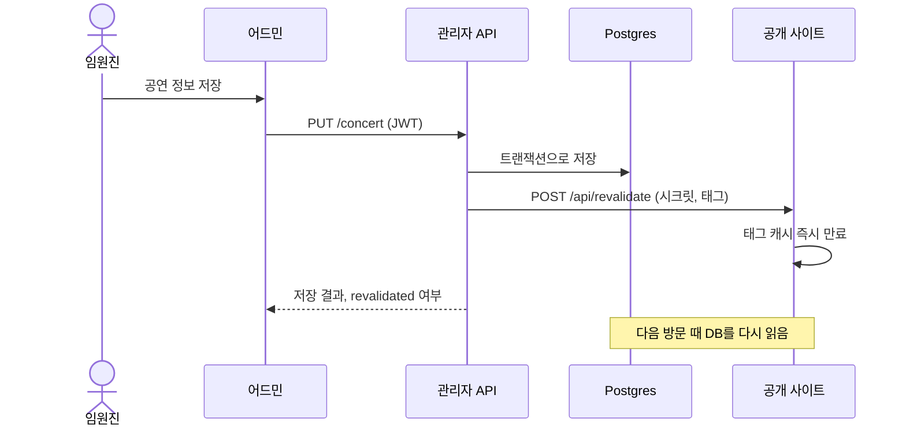
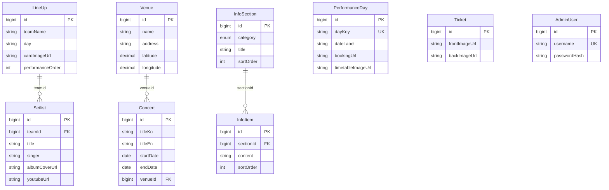
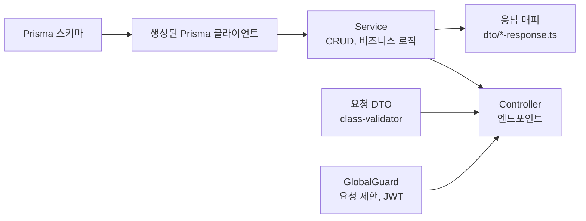
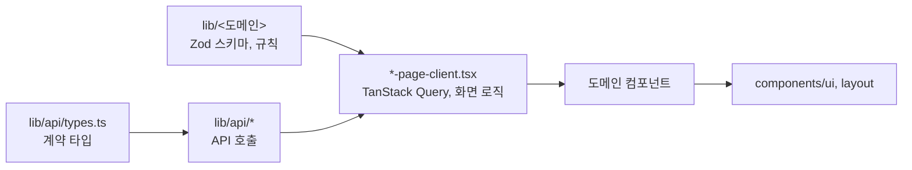
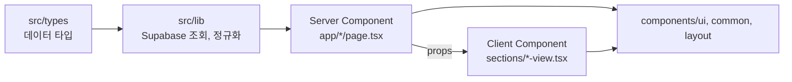

# 아키텍처와 의존성

SUMMIT Concert는 공개 사이트, 어드민, 관리자 API를 단일 저장소에 둔 멀티 앱 구성입니다. 시스템 그림은 [루트 README](../README.md#시스템-아키텍처)를 참고하세요. 앱별 상세는 [관리자 API](../apps/api/README.md)와 [어드민](../apps/admin/README.md) 문서에 있습니다.

## 저장소 구조

```text
src/              공개 사이트
public/           공개 사이트 정적 이미지
apps/admin/       어드민
apps/api/         관리자 API
docs/specs/       PRD와 단위 명세
docs/workflow/    Claude·Codex 협업 설계
scripts/ai/       PR 분류와 판정 스크립트
.github/          CI와 PR 검증 워크플로우
```

세 앱은 `package.json`과 `package-lock.json`을 각각 가지며, 워크스페이스나 공유 패키지는 없습니다.

## 콘텐츠 반영 흐름



재검증이 실패해도 저장은 유지되고, `revalidated: false`가 어드민에 전달됩니다. 공연 콘텐츠 캐시는 1시간 뒤 자동으로 갱신됩니다.

## 데이터 모델

`apps/api/prisma/schema.prisma` 기준입니다. 유튜브 리뷰 객체를 제거하는 마이그레이션 `20261027120000_drop_youtube_review_objects`는 운영 DB에 아직 적용되지 않았을 수 있습니다.



- `Concert`와 `Ticket`은 CHECK 제약으로 `id = 1` 한 행만 허용합니다.
- `PerformanceDay.dayKey`와 `LineUp.day`는 FK 없이 같은 값으로 연결합니다.
- 실제 테이블명 `Line Up`과 컬럼명 차이는 Prisma의 `@map`, `@@map`으로 처리합니다.

## Backend 의존 방향



Service는 Prisma를 직접 호출합니다. 저장이 끝나면 `RevalidationService`로 공개 사이트 캐시 재검증을 요청합니다. 외부 호출은 `storage`, `geocoding`, `album-cover`, `revalidation` 모듈에 모았습니다.

## Frontend 의존 방향

### 어드민



별도 hooks 폴더는 없습니다. 커스텀 훅은 인증용 `useAuth`, `useMe`, `useSessionRemainingMs` 3개이고, 도메인별 조회와 변경은 `*-page-client.tsx`에서 처리합니다.

### 공개 사이트



```text
src/
  app/          페이지, /api/revalidate
  components/
    layout/     헤더, 푸터
    sections/   페이지 섹션과 *-view.tsx
    ui/         카드, 모달, 이미지
    common/     지도, 애니메이션
  lib/          데이터 조회, 포맷, 재검증 검증
  types/        데이터 타입
```

데이터는 Server Component에서 조회하고, 상태나 이벤트가 필요한 부분만 Client Component로 분리합니다.

| 데이터 | 조회 위치 | 캐시 | 사용 페이지 |
| --- | --- | --- | --- |
| 공연, 공연장, 일차별 공연, 티켓, 안내 섹션 | `src/lib/concert-content.ts` | 태그 캐시, 1시간 자동 갱신 | 홈, 예매, 타임 테이블, 티켓, 오시는 길, 유의사항 |
| 일차별 출연진 | `getLineupByDay` | 태그 캐시 `lineup`, 1시간 자동 갱신 | 예매 |
| 팀, 곡 | `src/lib/fetch-line-up-and-setlist.ts` | `no-store` | `/setlist`, `/event-goods` |

## 앱 간 계약

공유 패키지가 없으므로 아래 항목은 양쪽을 함께 수정해야 합니다.

| 계약 | 위치 | 맞추는 방법 |
| --- | --- | --- |
| API 응답 타입 | `apps/api/src/*/dto`, `apps/admin/src/lib/api/types.ts` | 어드민에 미러링하고 원본 위치를 주석으로 표시 |
| 캐시 태그 | `apps/api/src/revalidation/content-tags.ts`, `src/lib/content-tags.ts` | 같은 값과 순서 유지 |
| 재검증 시크릿 | API와 공개 사이트의 `REVALIDATE_SECRET` | 같은 값 사용 |
| CORS | `apps/api/src/common/cors.ts`, 어드민 호출 | 메서드나 헤더를 추가하면 함께 확인 |
| DB 스키마 | Prisma 스키마, 공개 사이트 Supabase 조회 | 컬럼 변경 시 `src/lib` 조회와 RLS SELECT 정책 확인 |
