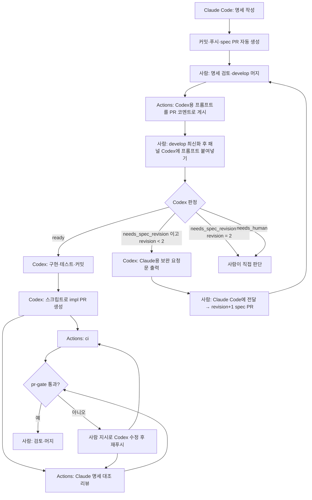

# Claude Code · Codex 업무 프로세스 연결 계획 (v1)

작성일: **2026-10-20 (한국 시간)**
공식 문서·Action 정의 확인일: 2026-10-17 (`claude-code-action` v1 `token.ts`의 토큰 처리 로직은 2026-10-20 확인).
목표 브랜치: **`develop`**
문서 범위: 자동화 설계, 설정 항목, 도입 순서, 검증 기준, 직접 확인 목록, 진행 표. 실제 저장소의 워크플로우나 계정 설정을 변경한 문서는 아니다.

근거 표기:

- **[확인]** 공식 문서·Action 정의·소스로 직접 확인한 사항
- **[권장]** 이 프로젝트의 운영 권장안
- **[미확인]** 문서만으로 확정하지 못한 사항. 도입 시 실제 환경에서 검증 (13.4)

---

## 0. 이 저장소 확정 사항 (2026-10-20)

계획 검토 후 사용자가 확정한 값이다. 아래 본문과 다르면 이 절이 우선한다.

| #   | 항목                 | 확정                                                                                                                                                                                                                       |
| --- | -------------------- | -------------------------------------------------------------------------------------------------------------------------------------------------------------------------------------------------------------------------- |
| 1   | 협업 형태            | `xodudgks` 단독. 승인 필수·CODEOWNERS 리뷰를 쓰지 않고, 다른 협업자에게 리뷰 권한을 주지 않는다                                                                                                                            |
| 2   | 명세 경로            | `docs/specs/` (2026-10-20 `.claude/docs/`에서 이동). 단위 명세는 `docs/specs/<SPEC_ID>.md`(대문자 ID, frontmatter 검사 대상), 그 외 파일(PRD·`work05-implementation.md` 등)은 관련 문서로 취급                              |
| 3   | 브랜치 접두사        | `spec/`·`impl/`·`maint/`만 사용. 명세 없이 사람이 직접 하는 작업(디자인·핫픽스 등)도 `maint/`. 기존 `feature/ fix/ docs/ chore/ design/ refactor/`는 전환 시점(Step 3)에 은퇴                                              |
| 4   | CI 구조              | `ci.yml`은 `workflow_call` + `push` 트리거로 바꾸고, `pr-validation.yml`이 호출한다. 루트에 타입 검사(`tsc --noEmit`) 추가. 비밀값은 `review` 잡에만 준다(`ci.yml` 원칙의 예외로 명시)                                        |
| 5   | 사람 작업 수용 기준  | 명세에 `AC-xx [manual]`로 표기. Codex는 그 지점에 오면 **작업을 멈추고 사용자에게 확인 요청**(무엇을·어떻게 확인하는지)을 출력한 뒤, 확인을 받고 진행한다. Claude 리뷰는 `[manual]`을 판정에서 제외하고 PR 본문 체크리스트로 남긴다 |
| 6   | Codex 범위           | 구현 → 커밋 → `create-impl-pr`로 **PR 생성까지**. PR 체크 확인과 머지는 사용자가 한다 (`git-rules.md`·`AGENTS.md`·`CLAUDE.md`는 Step 3에서 반영)                                                                           |
| 7   | Claude 작업 공간     | 별도 `git worktree` 사용. 위치는 OneDrive 밖                                                                                                                                                                               |
| 8   | Claude 리뷰 인증     | `CLAUDE_CODE_OAUTH_TOKEN` (`claude setup-token`으로 사용자가 직접 발급·등록). Claude 구독 한도를 쓰므로 추가 API 과금 없음, 설계 작업과 한도 공유. `ANTHROPIC_API_KEY`는 쓰지 않는다 (2026-10-20 API 키에서 변경)               |
| 10  | Codex 승인 설정      | 로컬 실행, 승인 정책 「요청 시」(`on-request`), 승인 처리자는 **사용자 직접**(입력창 방패 메뉴. `auto_review` 사용 금지 — AI 검토자가 샌드박스 밖 명령을 자동 허용함, 2026-10-20 확인). `gh`·`git push`에는 "항상 허용"을 주지 않는다 |
| 9   | 전환 시점            | Step 1~4(파이프라인 구축 + 파일럿)를 먼저 끝내고, work05 T2부터 새 흐름 적용                                                                                                                                                |

### 세팅 순서

| Step | 브랜치                 | 내용                                                                                                                                                                  |
| ---- | ---------------------- | --------------------------------------------------------------------------------------------------------------------------------------------------------------------- |
| 0    | (사람)                 | OAuth 토큰 발급·Secret 등록, 패널 Codex 로컬 실행·명령 승인 확인                                                                                                      |
| 1    | `maint/pr-validation`  | `ci.yml` 재사용화, `scripts/ai/classify-pr.mjs`, `pr-validation.yml`(`classify`·`ci`·`pr-gate`), 라벨. 머지 후 `develop` ruleset 설정과 차단 테스트(0-2)               |
| 2    | `maint/claude-review`  | 리뷰 프롬프트·스키마·`review` 잡. 리뷰 1회 성공, 빈 출력·실패·취소가 게이트를 통과하지 못하는지 확인                                                                   |
| 3    | `maint/spec-flow`      | 명세 템플릿, `design-pr` 커맨드, `spec-merged-notify.yml`, Codex 프롬프트 템플릿, `create-impl-pr.mjs`, `AGENTS.md`·`CLAUDE.md`·`git-rules.md` 새 흐름 반영(전환 시점) |
| 4    | 파일럿                 | `lib/src/lib/supabase.ts` 중복 파일 삭제(work01 잔여 #5)로 end-to-end 1건. 13.2 핵심 시나리오 확인, 비용 실측                                                          |
| 5    | work05 T2~            | `work05-implementation.md`의 T2~T5를 `docs/specs/WORK05-T2.md` 등으로 분할(완료 기준 → `AC-xx`, U1~U5 → `[manual]`)                                                  |

---

## 1. 채택할 운영 방식

**Claude가 명세를 만들고, 사람이 머지하면, 패널의 Codex가 판정·구현해 PR을 올리고, CI와 Claude 리뷰를 통과한 PR을 사람이 머지한다.**

| 항목                    | 기본 설정                                                                                      |
| ----------------------- | ---------------------------------------------------------------------------------------------- |
| 설계·명세 작성          | 로컬 Claude Code 설계 커맨드 (기존 구독)                                                       |
| 명세 PR 생성            | 설계 커맨드 마지막에 커밋·푸시·`gh pr create --base develop --label spec` (브랜치 `spec/...`)  |
| 명세 머지               | 사람                                                                                           |
| 머지 알림               | GitHub Actions가 PR에 **Codex용 프롬프트 코멘트** 게시 (AI 없음)                               |
| 판정 + 구현             | VS Code 패널 Codex, ChatGPT 로그인(구독). `gpt-6.1-sol` · medium 권장                          |
| 명세 보완               | Codex가 보완 요청문 출력 → 사람이 Claude Code에 전달 → 새 명세 PR(`revision` +1)               |
| 구현 PR 생성            | Codex가 로컬 스크립트로 생성 (내 계정, 브랜치 `impl/...`, `--label impl`)                      |
| 구현 검증               | 한 워크플로우의 `ci` + Claude 명세 대조 리뷰 + `pr-gate`                                       |
| 정책 파일 변경          | `maint/` 브랜치 PR (CI만 필수, 사람 검토)                                                      |
| 구현 머지               | 사람. 자동 머지 금지                                                                           |
| 서로 다른 명세 회차     | 최대 3개 (`revision` 0 → 1 → 2)                                                                |
| Claude 리뷰 모델 [권장] | `claude-sonnet-5-5`, `risk-high` 라벨 PR만 `claude-opus-5-5` (라벨 변경 후 리뷰는 수동 재실행) |
| Claude 인증 [확정]      | OAuth 토큰 (Claude 구독, 6.3). API 키는 쓰지 않음                                              |

---

## 2. 전체 흐름



자동 구간: **B(PR 생성), D(프롬프트 게시), I·J·K(검증)**. 사람이 시작하는 구간: E(Codex 시작), O(보완 전달).

---

## 3. 확인한 사항

### 3.1 GitHub 이벤트와 토큰 [확인]

- `GITHUB_TOKEN`이 만든 이벤트는 원칙적으로 새 워크플로우 실행을 만들지 않는다 (`workflow_dispatch`, `repository_dispatch` 예외). `GITHUB_TOKEN`으로 PR을 만들면 일부 이벤트는 사람의 승인 대기 상태로 실행이 생성된다.
- 이 계획에서는 PR을 **사람 계정(로컬 `gh`)이 만들기 때문에** 위 제한에 걸리지 않는다. 핵심 경로에 영향이 없다.
- 경로·브랜치 필터로 건너뛴 워크플로우의 체크는 "Pending"으로 남아 필수 체크가 걸린 PR의 머지를 막는다.

출처: [GitHub: Triggering a workflow](https://docs.github.com/en/actions/how-tos/write-workflows/choose-when-workflows-run/trigger-a-workflow)

### 3.2 Claude Action [확인]

- `prompt`를 주면 자동화 모드. `claude_args`로 `--model`, `--max-turns`, `--json-schema` 등을 전달하고 출력 `structured_output`을 받는다.
- **GitHub 인증**: `github_token`(내부적으로 override 토큰)을 주면 그대로 사용한다. 주지 않으면 OIDC 토큰을 받아 Claude GitHub App 토큰으로 교환한다(`id-token: write` 필요). `anthropic_api_key`는 모델 인증일 뿐 GitHub 인증을 대신하지 않는다. 교환 단계에서 `workflow_not_found_on_default_branch` 같은 워크플로우 검증 오류가 날 수 있다.
- 이슈·PR 이벤트에서는 트리거 사용자가 쓰기 권한을 가져야 한다. 봇 actor는 `allowed_bots`가 없으면 거부된다. 이 계획에서는 사람이 PR을 만들므로 해당 없다.
- PR에서 실행할 때 `.claude/`, `.mcp.json`, `CLAUDE.md` 등 설정 경로는 **PR base 브랜치 버전으로 복원**된다. `.github/ai/` 전체가 자동 복원되는 것은 아니다.
- 인증(모델): `anthropic_api_key`(API 과금) 또는 `claude_code_oauth_token`(`claude setup-token`, 발급한 사람의 구독 한도 사용).

출처: [claude-code-action v1 action.yml](https://github.com/anthropics/claude-code-action/blob/v1/action.yml), [token.ts](https://github.com/anthropics/claude-code-action/blob/v1/src/github/token.ts), [Claude Code GitHub Actions](https://code.claude.com/docs/en/github-actions)

### 3.3 `pull_request` 워크플로우의 출처

`pull_request` 이벤트의 워크플로우 파일은 PR의 병합 결과 기준으로 실행되므로, PR 안에서 `.github/workflows/`를 고치면 그 PR의 검증에 영향을 줄 수 있다. 그래서 워크플로우·정책 파일 변경은 `maint/` PR로 분리하고(10.3) 별도 사람 검토를 거친다. 기본 브랜치를 `develop`으로 바꾸는 일은 이 계획의 필수 조건이 아니다. 동작이 안 되면 원인(워크플로우 위치, 토큰 방식)을 확인하고 대응한다.

### 3.4 모델 선택 가이드 [확인]

OpenAI 공식 가이드: Astra = 가장 강력(고비용), GPT-6.1 Sol = 시간·비용을 함께 관리해야 하는 복잡한 작업, Luna = 효율 중심(범위가 정해진 작업). Sol · Medium이 "복잡한 기술 작업" 기준이다. 패널에서는 모델 선택 UI로 고른다.

출처: [OpenAI: Model selection](https://developers.openai.com/api/docs/guides/model-selection)

### 3.5 Codex 로그인 [확인]

로컬 IDE는 ChatGPT 로그인과 API 키 로그인을 모두 지원한다. 이 프로젝트의 패널은 **ChatGPT 로그인**이며(사용자 확인, 2026-10-20), 이 경우 OpenAI API 과금 없이 구독 한도를 쓴다. API 키로 로그인하면 API 과금으로 바뀌므로 로그인 방식을 바꾸지 않는다.

출처: [OpenAI: Authentication](https://learn.chatgpt.com/docs/auth)

---

## 4. 사전 점검 (Phase 0)

| #   | 점검                         | 통과 기준                                                                                                               | 실패 시                                            |
| --- | ---------------------------- | ----------------------------------------------------------------------------------------------------------------------- | -------------------------------------------------- |
| 0-1 | 저장소 공개 여부와 소유 플랜 | `develop`에 보호 규칙·필수 체크를 **실제로 설정**할 수 있음                                                             | 아래 대응                                          |
| 0-2 | 필수 체크 차단 테스트        | 일부러 실패시킨 체크가 있는 PR의 머지 버튼이 **차단**됨. 관리자(본인) 우회 설정도 확인                                  | 0-1과 동일                                         |
| 0-3 | 워크플로우 동작              | 테스트 PR에서 `pull_request` 워크플로우가 `develop` 대상으로 정상 실행됨                                                | 워크플로우 파일 위치·권한 설정 점검                |
| 0-4 | Claude 인증·Secrets          | `ANTHROPIC_API_KEY`(또는 OAuth 토큰) 등록, 콘솔 월 한도 설정                                                            | —                                                  |
| 0-5 | 로컬 `gh` 신원               | `gh auth status` 정상, `gh api user`의 로그인이 내 계정, `GH_TOKEN`·`GITHUB_TOKEN` 환경변수가 다른 신원을 선택하지 않음 | PR 작성자가 달라질 수 있음                         |
| 0-6 | 패널 Codex 실행 모드         | ChatGPT 로그인(확인됨) + **로컬 작업 디렉터리** 실행 + `git`·`gh`를 내 인증으로 사용. 첫 기능 실행 후 PR 작성자를 확인  | 클라우드 실행이면 작성자가 연동 봇일 수 있다 (9.2) |
| 0-7 | OS와 스크립트                | Windows면 Git Bash/WSL로 `.sh` 실행 가능 여부 확인. 아니면 PowerShell 또는 Node 스크립트로 작성                         | 9.3                                                |

**0-1·0-2 실패 시 대응 [권장]**: 개인 소유 private 저장소는 플랜에 따라 보호 규칙·필수 체크가 적용되지 않을 수 있다 [미확인]. 선택지는 (a) 지원되는 플랜 사용, (b) 저장소 공개(비밀 값 노출 검토 필요), (c) 강제 장치 없이 운영. (c)면 `pr-gate`는 **권고 수준**이고 머지 차단은 사람의 규율에 의존한다고 명시하고 진행한다.

---

## 5. 단계별 실행 계약

| 단계 | 주체                                                                                         | 수행 내용                                                                                                                               | 결과                  |
| ---- | -------------------------------------------------------------------------------------------- | --------------------------------------------------------------------------------------------------------------------------------------- | --------------------- |
| 1    | 사람 → 로컬 Claude Code                                                                      | 요구사항·수용 기준·범위·테스트 계획 작성. frontmatter에 `spec_id`, `revision`                                                           | 명세 파일             |
| 2    | 설계 커맨드 (자동)                                                                           | 커밋·푸시 후 `gh pr create --base develop --label spec`                                                                                 | 명세 PR               |
| 3    | 사람                                                                                         | 명세 검토 후 머지                                                                                                                       | `develop`에 명세 반영 |
| 4    | Actions (자동)                                                                               | 머지된 `spec` PR에 Codex용 프롬프트 코멘트 게시/갱신 (6.4)                                                                              | PR 코멘트             |
| 5    | 사람 → 로컬 준비 → 패널 Codex                                                                | 저장소·remote·작업 트리 확인, `develop` fast-forward 최신화(기존 작업이 있으면 임의 stash·reset 없이 별도 작업 경로), 프롬프트 붙여넣기 | Codex 세션 시작       |
| 6    | Codex                                                                                        | 명세와 코드를 읽고 JSON 판정 출력                                                                                                       | 판정                  |
| 6-a  | Codex (`ready`)                                                                              | revision 0·1·2 모두 해당. 구현 브랜치 생성, 구현, 테스트 실행, **허용 파일 커밋**                                                       | 구현 커밋             |
| 6-b  | Codex (`needs_spec_revision` 이고 `revision < 2`)                                            | 구현하지 않고 Claude용 보완 요청문 출력 후 종료                                                                                         | 보완 요청문           |
| 6-c  | Codex (`needs_spec_revision` 이고 `revision >= 2`, 또는 `needs_human`, 또는 메타데이터 오류) | 근거를 출력하고 종료                                                                                                                    | 사람 판단             |
| 7    | Codex                                                                                        | `create-impl-pr` 실행: 사전 검사 후 푸시, `gh pr create --base develop --label impl`                                                    | 구현 PR               |
| 8    | Actions (자동)                                                                               | `classify` → `ci` + Claude 리뷰 → `pr-gate`                                                                                             | 필수 체크             |
| 9    | 사람                                                                                         | 최신 커밋의 체크·리뷰 확인 후 머지                                                                                                      | `develop` 반영        |

머지되지 않고 닫힌 `spec` PR에는 프롬프트가 게시되지 않는다.

### 5.1 판정 규칙

```text
decision == ready                            → revision 0·1·2 모두 구현 가능
decision == needs_spec_revision && r < 2      → 보완 요청문 출력
decision == needs_spec_revision && r >= 2     → needs_human
decision == needs_human                       → 사람 판단
revision 누락·음수·비정수·2 초과              → 메타데이터 오류, 실행 중단
```

`revision`은 사람이 참여하는 보완 정책의 기록이며, 프롬프트만으로는 강제 상한이 아니다. 강제 지점은 명세 PR의 CI 검사다(10.3): 같은 `spec_id`의 보완은 `develop`에 있는 이전 revision +1이어야 한다. 같은 revision을 수동으로 다시 실행하는 것까지 막지는 않으므로 상한은 "서로 다른 명세 회차 최대 3개"로 표현한다.

---

## 6. 규칙과 메타데이터

### 6.1 연결 단위

| 항목                 | 예시                                                       |
| -------------------- | ---------------------------------------------------------- |
| 명세 ID              | `FEATURE-0123`                                             |
| 명세 경로            | 레포의 실제 위치에 맞춤 (예: `docs/specs/FEATURE-0123.md`) |
| 명세 브랜치          | `spec/FEATURE-0123-r0` (최초), `-r1`, `-r2`                |
| 구현 브랜치          | `impl/FEATURE-0123-spec-456` (`456` = 머지된 명세 PR 번호) |
| 정책·유지보수 브랜치 | `maint/<설명>`                                             |

```yaml
---
spec_id: FEATURE-0123
revision: 0
---
```

보완 요청으로 Claude가 명세를 고칠 때 `revision`을 1 올린다. 수용 기준에는 `AC-01` 같은 ID를 부여해 판정·리뷰와 연결한다.

### 6.2 구현 PR 본문 메타데이터

`create-impl-pr`이 PR 본문에 JSON 블록을 넣는다.

```json
{
  "spec_id": "FEATURE-0123",
  "spec_path": "docs/specs/FEATURE-0123.md",
  "revision": 0,
  "source_spec_pr": 456,
  "source_spec_merge_sha": "<명세 PR merge SHA>",
  "feasibility": "ready"
}
```

`pr-gate`는 이 값을 **신뢰 근거가 아니라 대조 대상**으로 다룬다. 대조 항목:

1. 브랜치명 `impl/<spec_id>-spec-<N>`과 `spec_id`·`source_spec_pr` 일치
2. `source_spec_pr`가 실제로 머지된 `spec` PR이고 merge SHA가 본문과 같음
3. 그 merge SHA의 명세 파일 내용 해시를 계산
4. **base(`develop`) 현재의 같은 `spec_id` 명세 경로**의 내용 해시와 revision을 계산해 3과 비교. 다르면 구버전 명세 구현이므로 실패("superseded")
5. 경로 이동·명세 분할이 있었다면 명시적 관계(메타데이터에 `supersedes` 등)가 없는 한 실패 처리하고 사람이 판단. 모든 `develop` 커밋이 명세 변경은 아니므로 `merge SHA == develop HEAD` 같은 비교는 쓰지 않는다

### 6.3 Claude 리뷰 인증과 비용

| 방식                       | 비용                             | 주의                                                                       |
| -------------------------- | -------------------------------- | -------------------------------------------------------------------------- |
| `ANTHROPIC_API_KEY` [권장] | 리뷰 1회 약 $0.3~0.5 (아래 가정) | 콘솔에서 월 한도 설정                                                      |
| `CLAUDE_CODE_OAUTH_TOKEN`  | 추가 API 과금 없음               | 설계 작업과 구독 한도를 공유. 사용량·추가 크레딧 정책은 구독 안내에서 확인 |

가정: Sonnet 5.5 입력 $2 / 출력 $10 (100만 토큰당)은 공식 모델 표에서도 확인된다. **리뷰 1회**가 입력 10~20만, 출력 1만 토큰이면 $0.30~0.50이다. 이를 "기능당 비용"으로 고정하지 않는다. 커밋마다 재검증하고, 에이전트가 파일을 반복해 읽으면 토큰이 누적되므로 기능당 비용은 리뷰 실행별 실제 사용량의 합이다. "월 10건 = $3~5"는 **각 기능이 리뷰 1회로 끝나는 시나리오**일 뿐이다. 첫 몇 건의 실제 사용량으로 보정한다. `risk-high`(Opus)는 더 비싸다. 두 인증 방식을 동시에 설정하지 않는다.

Codex 판정·구현은 ChatGPT 구독 한도를 쓴다. 비용 0이 아니라 "추가 API 과금 없음"이며, 한도 소진 시 중단될 수 있다.

### 6.4 프롬프트 코멘트

- 포함: `spec_id`, 명세 PR 번호, 명세 경로, merge SHA, `revision`, 템플릿 버전
- 식별용 숨은 마커(예: `<!-- codex-prompt:FEATURE-0123:r0 -->`)를 넣어, 워크플로우를 재실행하면 기존 코멘트를 **갱신**하고 중복 게시하지 않는다

---

## 7. 명세 보완 루프 (수동)

1. Codex가 `needs_spec_revision`이고 `revision < 2`이면 구현하지 않고, **Claude용 보완 요청문**을 하나의 코드 블록으로 출력한다. 포함: 명세 경로, 현재 `revision`, 막힌 수용 기준 ID, 이유, 요청 변경.
2. 사람이 요청문을 로컬 Claude Code에 붙여넣는다. Claude가 명세를 고치고 `revision`을 +1 한 뒤 설계 커맨드로 `spec/FEATURE-0123-r{N}` 명세 PR을 만든다.
3. 사람이 머지하면 4단계 코멘트가 갱신되고 5단계부터 반복한다.
4. `revision`이 2인 명세가 다시 `needs_spec_revision`이면 `needs_human`으로 종료한다. 사람이 범위를 정리하거나 명세를 쪼갠다. (r2가 `ready`면 정상 구현한다.)

이 루프의 빈도를 처음 몇 건 기록한다. 잦다면 명세 템플릿이나 설계 프롬프트에 부족한 부분이 있다는 신호다.

---

## 8. 워크플로우와 파일 구성

### 8.1 추가할 파일 (제안)

| 제안 경로                                    | 책임                                                             |
| -------------------------------------------- | ---------------------------------------------------------------- |
| `.claude/commands/design-pr.md`              | 설계 커맨드에 커밋·푸시·명세 PR 생성 연결, `revision` 갱신       |
| `AGENTS.md`, `CLAUDE.md`                     | 자동 머지 금지, 명세 준수, 변경 범위, Codex 판정·종료 규칙 (9.1) |
| `docs/ai/codex-prompt.template.md`           | 4단계 코멘트가 채울 Codex 프롬프트 템플릿                        |
| `scripts/ai/create-impl-pr.*`                | 구현 PR 생성 (OS에 맞는 형식, 0-7)                               |
| `scripts/ai/classify-pr.*`                   | CI와 로컬이 **같은 규칙**으로 PR 분류·경로 검사 (10.3)           |
| `.github/workflows/spec-merged-notify.yml`   | 4단계: 프롬프트 코멘트 게시/갱신                                 |
| `.github/workflows/pr-validation.yml`        | `classify`, `ci`, `review`, `pr-gate`                            |
| `.github/ai/prompts/spec-review.md`          | Claude 리뷰 프롬프트                                             |
| `.github/ai/schemas/spec-review.schema.json` | Claude 리뷰 JSON Schema                                          |

### 8.2 명세 머지 알림 (4단계)

```yaml
on:
  pull_request:
    branches: [develop]
    types: [closed]

permissions:
  contents: read
  pull-requests: write

jobs:
  notify:
    if: >-
      github.event.pull_request.merged == true &&
      startsWith(github.event.pull_request.head.ref, 'spec/')
    runs-on: ubuntu-latest
    # steps: 템플릿에 검증된 spec_path, merge SHA, revision을 채워 코멘트 게시/갱신
```

발췌 예시이며 완성된 파일이 아니다.

- PR 제목·본문·브랜치명을 쉘에 직접 끼워 넣지 않는다 (`env:`로 전달, 정규식 검증).
- 코멘트에 넣는 값은 검증된 `spec_path`(허용 디렉터리 패턴), 머지 SHA, `revision`뿐이다.
- 비밀 값·AI 호출 없음. Actions 러너 포함 시간은 소량 소모한다.

### 8.3 구현 PR 검증 (8단계)

한 워크플로우(`pr-validation.yml`)에 네 개의 작업을 둔다.

```yaml
on:
  pull_request:
    branches: [develop]
    types: [opened, synchronize, reopened, ready_for_review]

permissions:
  contents: read
  pull-requests: read
  issues: read
```

| 작업       | 내용                                                                                                    |
| ---------- | ------------------------------------------------------------------------------------------------------- |
| `classify` | 브랜치 접두사와 변경 파일 경로로 분류 (`spec` / `impl` / `maint` / 분류 불가)                           |
| `ci`       | lint·타입·테스트·빌드. 모든 대상 PR                                                                     |
| `review`   | `classify`가 `impl`일 때만 Claude 명세 대조 리뷰 (10.1). **실행되면 매번 새로 수행** (결과 재사용 없음) |
| `pr-gate`  | `needs: [classify, ci, review]`, `if: always()`. 분류별 규칙으로 최종 판정 (10.2)                       |

**이 구성의 이유**: 이벤트를 위 4개로 제한하면 모든 실행에서 `classify`가 같은 입력으로 같은 결정을 내리므로, "게이트는 돌았는데 리뷰는 skipped" 상태가 `impl`에서 생기지 않는다. `review`가 skipped인 것은 `classify`가 `impl`이 아니라고 했을 때뿐이고, 그때 게이트는 해당 분류의 규칙을 적용한다. 라벨 변경은 어떤 작업도 다시 시작하지 않는다.

비용 최적화(같은 head·base·명세 해시·정책 해시·모델·위험도 키로 결과 재사용)는 정확한 동작을 확인한 뒤 추가한다. 추가한다면 키 전체를 쓰고, 신뢰하는 이전 실행의 pass만 재사용하며, 이 방식과 매번 실행 방식을 섞지 않는다. `risk-high`를 나중에 붙이면 리뷰를 수동 재실행한다.

---

## 9. Codex 패널 운영

### 9.1 프롬프트와 AGENTS.md

프롬프트(템플릿)는 다음을 지시한다.

1. 지정된 명세 파일(merge SHA 기준)과 관련 코드를 읽는다.
2. 구현 전에 아래 JSON 판정을 먼저 출력한다. 판정 규칙은 5.1을 따른다.
3. `ready`일 때만 `impl/<spec_id>-spec-<N>` 브랜치를 만들어 구현하고, 테스트를 실제 실행해 명령·결과를 기록한 뒤 **커밋한다**.
4. `needs_spec_revision`이면 구현하지 않고 Claude용 보완 요청문을 출력하고 종료한다.
5. `create-impl-pr`로 PR을 만든다. **머지하지 않는다. `develop`에 직접 푸시하지 않는다.**

```json
{
  "decision": "ready | needs_spec_revision | needs_human",
  "spec_id": "FEATURE-0123",
  "revision": 0,
  "summary": "한 줄 요약",
  "blockers": [
    { "requirement_id": "AC-03", "reason": "…", "requested_change": "…" }
  ]
}
```

`AGENTS.md`의 "막히면 멈추고 보고"는 `needs_human` 종료로 그대로 쓴다. 기존 금지사항(예: `migrate dev` 금지)도 유지한다. `ready` 판정은 구현 성공을 보장하지 않는다. 테스트가 실패한 채 PR을 올리지 않고 결과를 보고한 뒤 사람의 지시를 기다린다.

### 9.2 PR 작성자와 실행 모드

`create-impl-pr`은 로컬 `git`, `gh`의 **내 인증**으로 실행되므로 PR 작성자가 나이고 CI가 정상 시작된다. 패널 Codex가 클라우드 작업 방식으로 푸시·PR하면 작성자가 연동 봇일 수 있고, 그러면 승인 대기나 Claude Action의 봇 거부가 생길 수 있다 [미확인]. 첫 기능 실행 후 `gh pr view --json author`로 작성자를 확인하고, 클라우드 실행은 기본 경로에서 제외한다.

### 9.3 스크립트 규칙

`create-impl-pr`은 PR을 만들기 전에 다음을 검사한다.

- 현재 브랜치가 `impl/<spec_id>-spec-<N>` 형식이고 `develop`이 아님
- 작업 트리가 깨끗함(이미 커밋됨). 커밋은 앞 단계에서 허용된 파일만 대상으로 한다
- `classify-pr`과 **같은 규칙**으로 변경 경로 검사: 워크플로우·정책 경로(10.3)를 포함하면 중단
- `<N>`이 머지된 `spec` PR인지 `gh`로 확인하고 merge SHA를 가져옴
- 같은 브랜치의 열린 PR이 있으면 새로 만들지 않고 갱신
- PR 본문은 `--body-file`, 라벨 `impl`
- `gh api user` 결과를 출력해 어떤 신원으로 실행되는지 보이게 한다

로컬 검사만으로 강제된 것으로 보지 않는다. 같은 분류 규칙을 CI(`classify`)가 다시 적용한다.

### 9.4 모델 사용 기준 [권장]

| 작업                  | 모델 · effort          | 비고                                 |
| --------------------- | ---------------------- | ------------------------------------ |
| 판정 + 구현           | `gpt-6.1-sol` · medium | 한 세션에서 연속 수행해 맥락 재사용  |
| 범위가 아주 작은 수정 | Luna · low             | 명세가 작고 범위가 명확할 때         |
| 막히는 작업의 재시도  | Astra                  | 고비용·한도 소모가 크므로 수동으로만 |

---

## 10. Claude 명세 대조 리뷰와 머지 차단

### 10.1 리뷰 구성

Claude는 연결된 명세의 각 수용 기준에 `충족 / 미충족 / 판단 불가`를 기록하고 근거를 제시한다. 범위 밖 변경, 오류 처리, 권한, 호환성도 본다. JSON Schema로 검증 가능한 판정을 받는다. 리뷰는 **읽기만** 한다. 테스트는 독립 CI가 수행한다.

```yaml
review:
  needs: classify
  if: needs.classify.outputs.kind == 'impl'
  steps:
    # 신뢰하는 base 버전의 프롬프트·스키마를 별도 경로로 체크아웃하고
    # 명세·diff·고정 프롬프트를 선행 step에서 준비한다.
    - name: Review specification compliance
      id: review
      uses: anthropics/claude-code-action@v1 # 운영 전에 검토한 커밋 SHA로 고정
      with:
        claude_code_oauth_token: ${{ secrets.CLAUDE_CODE_OAUTH_TOKEN }}
        github_token: ${{ github.token }}
        base_branch: develop
        prompt: ${{ steps.build_prompt.outputs.prompt }}
        claude_args: |
          --model claude-sonnet-5-5
          --max-turns 20
          --tools "Read,Glob,Grep"
          --allowedTools "Read,Glob,Grep"
          --disallowedTools "mcp__*"
          --json-schema '<실제 리뷰 JSON Schema>'
```

입력 구성을 보이는 발췌이며 완성된 파일이 아니다.

- `github_token`을 명시해 OIDC·Claude GitHub App 교환을 피한다 [확인]. 이 작업은 읽기 권한만 갖는다.
- `--tools`·`--allowedTools`·`--disallowedTools` 구성과 `--model` 문자열은 외부 점검 제안이며 **실제 프롬프트·스키마·입력 파일로 시험해 확인한다** [미확인].
- PR에 결과를 게시하려면 별도 단계에 `pull-requests: write`를 부여한다. 게이트는 `structured_output`을 직접 읽으므로 코멘트 게시는 선택이다.
- 프롬프트·스키마·검증 코드는 base(`develop`)에서 읽는다. `risk-high`는 `claude-opus-5-5`로 바꾼다. `allowed_bots`는 설정하지 않는다.

스키마는 최소한 `verdict`, `spec_merge_sha`, `reviewed_head_sha`, 수용 기준별 결과, 차단 사유를 포함한다. 성공 조건: Action 성공 + 유효 JSON + `reviewed_head_sha`가 현재 head와 일치 + `spec_merge_sha`가 메타데이터와 일치 + `verdict=pass`. 빈 출력·스킵·실패·취소는 모두 실패다.

### 10.2 `pr-gate` 규칙

| 분류      | 통과 조건                                                                                                                   |
| --------- | --------------------------------------------------------------------------------------------------------------------------- |
| `impl`    | `ci` 성공 + `review` 성공(10.1) + 6.2 메타데이터 대조 통과                                                                  |
| `spec`    | `ci` 성공 + 명세 형식(frontmatter, `AC-xx`) 검사 + 변경 파일이 명세·관련 문서 경로에만 있음 + revision이 이전 +1 (최초는 0) |
| `maint`   | `ci` 성공 (사람이 직접 검토하고 머지)                                                                                       |
| 분류 불가 | **실패.** 알 수 없는 분류를 자동 통과시키지 않는다                                                                          |

`pr-gate`는 `if: always()`로 실행하고 상위 작업 결과를 확인한다. 필수 워크플로우에는 경로 필터로 실행이 빠지는 구성을 피한다. 건너뛴 체크는 Pending으로 남는다 [확인]. 필수 체크 이름은 실제 실행 후 표시되는 이름으로 등록한다. CI는 AI가 쓴 "테스트 통과" 문장을 신뢰하지 않고 독립 실행한다.

### 10.3 분류와 정책 경로

`classify`(와 로컬 `classify-pr`)는 같은 규칙을 쓴다. 브랜치 접두사만 보지 않고 **실제 diff 경로**로 대조한다.

| 경로 종류                    | 설명                                                                                |
| ---------------------------- | ----------------------------------------------------------------------------------- |
| 명세 경로                    | `docs/specs/**`. `spec` PR은 이 경로와 관련 문서에만 변경이 있어야 한다             |
| 정책 경로                    | `.github/**`, `CLAUDE.md`, `AGENTS.md`, `.claude/**`, `docs/ai/**`, `scripts/ai/**` |
| 그 외(코드·테스트·일반 문서) | `impl` PR의 변경 범위                                                               |

- `spec` PR에 코드가 섞이면 명세 경로로 통과하지 못한다. `impl` PR에 정책 경로가 섞이면 실패한다.
- 정책 경로의 변경은 `maint/` PR로 따로 올리고 사람이 직접 검토한다. 리뷰 기준·프롬프트·스키마를 바꾸는 수정은 반드시 먼저 `maint/`로 머지한다.
- 이 규칙은 `.github/`에 들어 있어 PR 안에서 바뀔 수 있다. 그래서 `maint/` 분리와 사람 검토가 실제 방어선이다. 보호 규칙을 적용할 수 있으면 `CODEOWNERS`로 정책 경로 소유자를 지정한다.

### 10.4 보호 규칙

(Phase 0에서 설정 가능 여부 확인)

| 체크·정책                 | 설정                                                                                                                                                         |
| ------------------------- | ------------------------------------------------------------------------------------------------------------------------------------------------------------ |
| `pr-gate`                 | 필수 체크 (`ci`는 `pr-gate`가 포함해 확인하므로 별도 등록은 선택)                                                                                            |
| **머지 전 브랜치 최신화** | **Require branches to be up to date before merging** 적용. base가 바뀌면 게이트와 필요한 리뷰를 다시 계산한다. 적용하지 않으면 이전 성공 결과가 남을 수 있다 |
| 직접 푸시                 | `develop` 직접 푸시 금지, PR 필수                                                                                                                            |
| 자동 머지                 | 사용하지 않음                                                                                                                                                |
| 승인 요구                 | **사용하지 않음** (단독 작업 확정, 0장 #1). 켜면 본인 PR을 승인할 수 없어 막힌다                                                                             |

**한계 [확인된 구조]**: Codex가 내 인증을 쓰므로 GitHub는 사람과 에이전트를 구분하지 못한다. 보호 규칙은 `develop` 직접 푸시를 막을 수 있어도 에이전트가 일반 merge API를 호출하는 것까지 막았다고 말할 수 없다. 방어는 `AGENTS.md`의 "머지 금지"와 패널의 명령 승인 설정에 의존한다.

---

## 11. 인증·권한

| 설정                                               | 용도                                    |
| -------------------------------------------------- | --------------------------------------- |
| `ANTHROPIC_API_KEY` 또는 `CLAUDE_CODE_OAUTH_TOKEN` | Claude 리뷰 모델 인증 (둘 중 하나만)    |
| `github_token: ${{ github.token }}`                | Claude Action의 GitHub 인증 (읽기 권한) |
| 로컬 `gh` 로그인                                   | 명세 PR·구현 PR 생성 (내 계정)          |
| ChatGPT 로그인                                     | 패널 Codex (저장소 Secret 불필요)       |

| 작업                   | GitHub 토큰                                               | AI 인증             |
| ---------------------- | --------------------------------------------------------- | ------------------- |
| 명세 머지 알림         | `GITHUB_TOKEN` (`contents: read`, `pull-requests: write`) | 없음                |
| `classify`·`ci`        | `contents: read`                                          | 없음 (AI 키 비노출) |
| `review`               | `contents: read`, `pull-requests: read`, `issues: read`   | Claude 키           |
| 결과 코멘트 게시(선택) | `pull-requests: write` (별도 작업)                        | 없음                |

- 외부 fork PR은 일반 CI만 자동 실행하고, 비밀 값이 필요한 AI 리뷰는 신뢰 확인 뒤에만 돌린다. `pull_request_target`에서 PR 코드를 체크아웃해 비밀 값과 함께 실행하지 않는다.
- 이 구조에는 쓰기 권한을 가진 GitHub App/PAT가 없다. 대신 **내 로컬 인증을 에이전트가 쓸 수 있다**는 점이 보안 경계다(10.4 한계).

---

## 12. 비용·실패 운영

### 12.1 추가 비용

| 항목            | 추가 비용                                                                                                   |
| --------------- | ----------------------------------------------------------------------------------------------------------- |
| Codex 판정·구현 | 추가 API 과금 없음 (ChatGPT 구독 한도 사용)                                                                 |
| Claude 설계     | 추가 없음 (기존 구독)                                                                                       |
| Claude 리뷰     | API 키: 리뷰 1회 약 $0.3~0.5 (6.3의 가정). 커밋마다 누적 / OAuth: 추가 API 과금 없음, 구독 한도 공유        |
| GitHub Actions  | 비공개 저장소는 플랜 포함 시간 내 예상 (제3자 자료 기준 Free 월 2,000분). 도입 시 공식 요금 페이지에서 확인 |

### 12.2 통제

- Claude 리뷰: `--max-turns`, `timeout-minutes`(시작값 15분), 실패 시 무제한 재실행 금지, 읽기 도구만 허용
- Claude 콘솔 월 지출 한도 설정
- 리뷰 입력은 연결된 명세와 PR diff 중심으로 제공
- Codex 쪽은 한도 소진·반복을 사람이 패널에서 보고 중단

### 12.3 실패 유형별 처리

| 유형                                           | 처리                                                                  |
| ---------------------------------------------- | --------------------------------------------------------------------- |
| 명세 누락·모순                                 | 7장 수동 보완 루프                                                    |
| 보완 상한 도달                                 | 사람이 범위 조정·명세 분할                                            |
| Claude 인증·429·시간 초과                      | `pr-gate` 실패 유지, 재실행은 사람이 수동으로                         |
| 테스트·Claude 리뷰 실패                        | 머지 차단, Codex에 수정 지시 후 재푸시(새 head로 CI·리뷰 모두 재실행) |
| 더 새로운 명세가 머지된 뒤 이전 구현 머지 시도 | 6.2의 4번 대조(`develop` 현재 명세 해시·revision)에서 실패            |
| `develop`이 앞서간 구현 PR                     | 최신화 후 게이트·리뷰 재계산 (10.4)                                   |
| 동일 명세로 PR을 두 번 생성                    | 스크립트가 기존 PR을 갱신                                             |
| 분류 불가 PR                                   | 게이트 실패, 접두사(`spec/`·`impl/`·`maint/`)에 맞게 PR 재구성        |

---

## 13. 도입 순서, 인수 테스트, 열린 항목

### 13.1 도입 순서

1. **Phase 0**: 4장 점검. 0-2(필수 체크 차단)를 통과하기 전에는 다음으로 넘어가지 않는다.
2. **Phase 1: 검증 파이프라인** — `classify`·`ci`·`pr-gate` 먼저(실패 체크가 머지를 막는지 확인) → Claude 리뷰 1회를 읽기 전용 구성으로 성공시키고 빈 결과·실패가 게이트를 통과하지 못하는지 확인 → 6.2 대조·10.3 분류·E 규칙 구현.
3. **Phase 2: 명세·구현 연결** — 설계 커맨드 연결, `spec-merged-notify.yml`, 프롬프트 템플릿, `create-impl-pr`, `AGENTS.md`. 작은 기능 하나로 끝까지 실행.
4. **Phase 3 (선택)**: `develop` 푸시 시 통합 점검, 리뷰 결과 재사용 캐시, 보완 루프 빈도가 높으면 명세 템플릿 개선.

### 13.2 인수 테스트

| 시나리오                                 | 기대 결과                                       |
| ---------------------------------------- | ----------------------------------------------- |
| 필수 체크가 실패한 PR 머지 시도          | 머지 차단 (Phase 0)                             |
| 정상 `spec` PR 머지                      | Codex 프롬프트 코멘트 게시                      |
| 같은 워크플로우 재실행                   | 코멘트 중복 없이 갱신                           |
| `spec` PR을 머지 없이 닫음               | 코멘트 없음                                     |
| PR 제목에 쉘 문자                        | 쉘 실행 없음                                    |
| `spec/` PR에 코드 파일 포함              | `pr-gate` 실패                                  |
| `impl/` PR에 `.github/` 파일 포함        | `pr-gate` 실패                                  |
| 접두사가 없는 브랜치 PR                  | 분류 불가로 실패                                |
| `ready` 판정 후 구현 (revision 0·1·2)    | 모두 `impl/` 브랜치 PR 생성                     |
| `needs_spec_revision` (revision 0·1)     | 구현 없이 Claude용 요청문                       |
| `needs_spec_revision` (revision 2)       | 요청문 없이 `needs_human` 종료                  |
| 메타데이터 `revision` 누락·범위 초과     | 실행 중단                                       |
| 같은 revision으로 보완 PR (이전 +1 아님) | `spec` PR 검사 실패                             |
| 패널에서 만든 `impl` PR                  | 승인 대기 없이 CI·리뷰 자동 실행, 작성자가 본인 |
| 같은 명세로 스크립트 두 번 실행          | PR 중복 없음                                    |
| 통과한 PR에 라벨만 추가·제거             | 어떤 작업도 재실행되지 않고 기존 통과 상태 유지 |
| 브랜치명·메타데이터 변조                 | `pr-gate` 실패                                  |
| Claude 출력 누락·스킵·취소·빈 결과       | `pr-gate` 실패                                  |
| PR에 새 커밋 추가                        | CI와 리뷰 모두 재실행                           |
| `develop`이 먼저 바뀐 PR                 | 최신화 요구, 재계산 후 통과                     |
| 테스트 실패·Claude 지적                  | 머지 차단                                       |
| 새 명세 머지 후 이전 구현 머지 시도      | `pr-gate` 실패(superseded)                      |
| Codex가 `develop` 직접 푸시 시도         | 보호 규칙으로 차단 (지원 플랜일 때)             |

완료 기준: 대상 저장소에서 위 시나리오를 통과하고 필수 체크를 등록한 시점.

### 13.3 채울 값

| 항목                  | 값 (2026-10-20 확인)                                                                                                                                      |
| --------------------- | --------------------------------------------------------------------------------------------------------------------------------------------------------- |
| 저장소 플랜·보호 규칙 | `SUMMIT-Band-Dev/SUMMIT_CONCERT`, Public, org Free 플랜 → 보호 규칙·ruleset 사용 가능. 현재 `develop` 보호 없음. 차단 테스트(0-2)는 Step 1에서               |
| 명세 경로·정책 경로   | 명세 `docs/specs/**`, 정책 경로는 10.3 표 그대로                                                                                                          |
| 기존 Claude 커맨드    | `.claude/commands/git/commit.md`, `.claude/commands/git/push.md` (설계 커맨드는 Step 3에서 `design-pr.md` 신설)                                            |
| Claude 인증 방식      | OAuth 토큰 (`CLAUDE_CODE_OAUTH_TOKEN`, Claude 구독)                                                                                                       |
| 테스트 명령           | 기존 `ci.yml` 기준 — `apps/api`: lint·build·test·typecheck / `apps/admin`: lint·build·typecheck·test / 루트: lint (+ Step 1에서 `tsc --noEmit` 추가). 테스트 DB 없음 |
| 월 예산               | 추가 과금 없음 (구독 한도 사용). 비용 통제는 `--max-turns`·`timeout-minutes`·리뷰 입력 축소로 한도 소모를 줄이는 방식                                           |
| 스크립트 형식         | Node(`.mjs`) — 로컬 Windows와 CI ubuntu에서 같은 규칙 모듈 공유                                                                                            |
| 기본 브랜치·기존 CI   | 기본 브랜치 `develop`, 기존 CI `.github/workflows/ci.yml`                                                                                                 |
| `gh` 신원 (0-5)       | `xodudgks`, `GH_TOKEN`·`GITHUB_TOKEN` 비어 있음 — 통과                                                                                                     |

### 13.4 확인하지 못한 항목 [미확인]

| 항목                                                                 | 확인 방법                                            |
| -------------------------------------------------------------------- | ---------------------------------------------------- |
| 저장소 플랜별 보호 규칙·필수 체크 적용 범위, 관리자 우회             | 설정 화면, Phase 0-2 차단 테스트                     |
| 패널 Codex의 로컬/클라우드 실행 방식과 PR 작성자                     | 첫 기능 실행 후 `gh pr view --json author`           |
| Claude Action 읽기 전용 도구 구성(`--tools` 등)과 `--model` 문자열   | 실제 프롬프트·스키마로 소규모 테스트                 |
| `github_token`을 직접 줄 때 워크플로우 검증 조건이 완전히 사라지는지 | 소규모 테스트                                        |
| PR 생성 직후 라벨이 이벤트에 실리는지                                | 분류가 브랜치명·경로 기준이라 영향 작음. 참고용 확인 |
| 요금표(Claude API, GitHub Actions)                                   | 도입 시점의 공식 요금 페이지                         |
| ChatGPT 구독별 Codex 사용 한도, 패널 모델 선택 UI                    | 패널 설정과 구독 안내                                |

실제 YAML을 배포할 때는 예시 경로·변수를 저장소 값으로 바꾸고, 선택한 Action 커밋의 정의와 다시 대조한다.

---

## 14. 사람이 직접 확인할 것

내가(또는 에이전트가) 대신 확인할 수 없고, 대상 저장소·계정에서 직접 봐야 하는 것만 모았다.

| #   | 확인                                                                                            | 방법                                                                                          | 결과가 영향을 주는 곳           |
| --- | ----------------------------------------------------------------------------------------------- | --------------------------------------------------------------------------------------------- | ------------------------------- |
| 1   | `develop` 보호 규칙·필수 체크가 **실제로 머지를 막는가**                                        | 테스트 PR에 일부러 실패하는 체크를 만들고 머지 버튼 확인. 본인(관리자) 우회가 되는지도 확인   | 10.4, 4장 대응 (a)(b)(c) 선택   |
| 2   | 저장소 공개 여부·플랜, 협업자 유무                                                              | Settings 화면                                                                                 | 승인 요구 설정 여부             |
| 3   | `gh` 신원                                                                                       | `gh auth status`, `gh api user --jq .login`, 환경변수 `GH_TOKEN`·`GITHUB_TOKEN`이 비어 있는지 | PR 작성자, CI 트리거            |
| 4   | 패널 Codex가 **로컬**에서 실행되는지, 명령 승인 설정이 켜져 있는지                              | 첫 기능에서 작업 디렉터리·푸시 주체 확인, 패널 설정                                           | 9.2, 10.4 한계                  |
| 5   | Codex가 ChatGPT 로그인 상태 유지 (API 키로 바뀌지 않았는지)                                     | 패널 계정 표시                                                                                | 과금 경로 (확인됨, 유지만 점검) |
| 6   | Claude 리뷰 인증 방식 결정과 키 등록, 콘솔 월 지출 한도                                         | Anthropic 콘솔, 저장소 Secrets                                                                | 6.3, 12                         |
| 7   | 작업 환경 OS                                                                                    | Windows면 Git Bash/WSL 사용 가능 여부                                                         | 스크립트 형식                   |
| 8   | 저장소 사실: 명세 경로, 기존 설계/커밋/푸시 커맨드 경로, 테스트 명령, 기존 CI 유무, 기본 브랜치 | 저장소 확인                                                                                   | 13.3                            |
| 9   | 첫 기능 실측: Claude 리뷰 비용, Codex 한도 소모                                                 | 콘솔 사용량, 패널 사용량                                                                      | 6.3 보정                        |

---

## 15. 진행 계획 표

상태 칸은 진행하면서 직접 갱신한다.

| Phase | 작업                                                          | 완료 기준                                     | 담당      | 상태 |
| ----- | ------------------------------------------------------------- | --------------------------------------------- | --------- | ---- |
| 0     | 14장 1~9 중 1·3·4·6·7·8 확인                                  | 값이 13.3에 채워짐                            | 사람      | ◐ (2·3·7·8 완료, 1·4·6 남음) |
| 0     | 필수 체크 차단 테스트                                         | 실패 체크 PR이 머지 불가 (또는 (c) 방침 기록) | 사람      | ☐    |
| 1     | `classify` + `ci` + `pr-gate` 워크플로우                      | 분류별 규칙대로 통과·실패                     | 구현      | ☐    |
| 1     | Claude 리뷰 읽기 전용 구성, 스키마                            | 리뷰 1회 성공, 빈 결과·실패는 게이트 실패     | 구현      | ☐    |
| 1     | 6.2 메타데이터·`develop` 현재 명세 대조                       | superseded·변조 시 실패                       | 구현      | ☐    |
| 1     | 보호 규칙 적용 (strict 포함)                                  | 10.4 표대로 설정                              | 사람      | ☐    |
| 2     | 명세 템플릿(`spec_id`, `revision`, `AC-xx`), 설계 커맨드 연결 | 명세 PR이 `spec/` 브랜치로 자동 생성          | 구현      | ☐    |
| 2     | `spec-merged-notify.yml` + 프롬프트 템플릿                    | 머지 시 코멘트 게시/갱신                      | 구현      | ☐    |
| 2     | `create-impl-pr`, `classify-pr`, `AGENTS.md`                  | 로컬 검사·CI 분류가 일치                      | 구현      | ☐    |
| 2     | 작은 기능 1개 end-to-end                                      | 13.2 핵심 시나리오 통과, PR 작성자 확인       | 사람+구현 | ☐    |
| 3     | 비용 실측 후 한도·`--max-turns` 조정, 필요 시 재사용 캐시     | 월 예산 내                                    | 사람      | ☐    |
